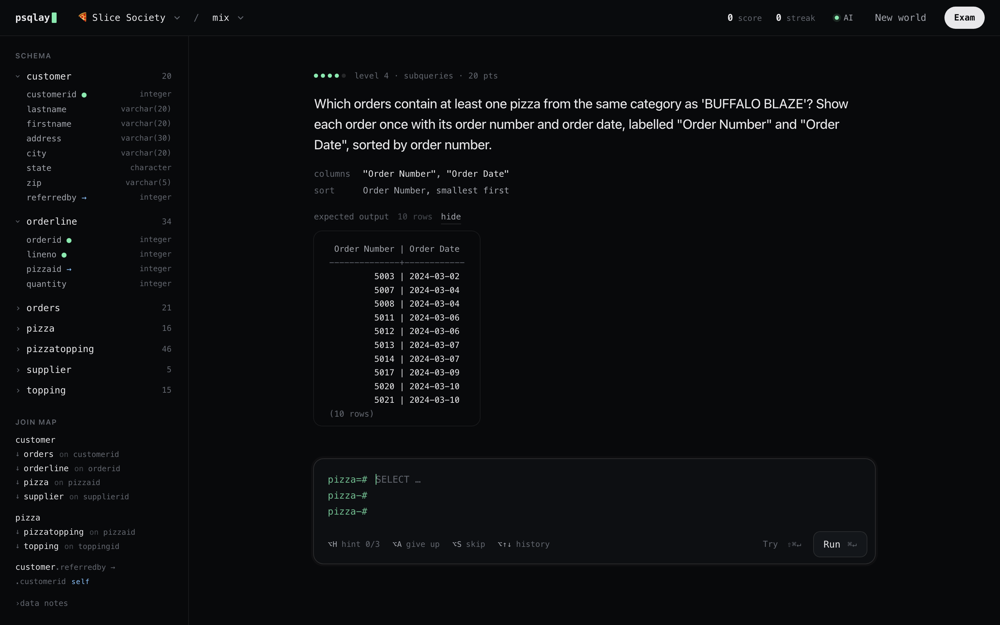

<div align="center">

<picture>
  <source media="(prefers-color-scheme: dark)" srcset="docs/img/logo-dark.svg">
  
</picture>

**Endless SQL practice for PostgreSQL. In your terminal or your browser.**

Exam-style questions, graded by comparing **results, not query text**.<br>
Runs on your machine. No account. API key optional.

<a href="#quick-start">Quick start</a> ·
<a href="#features">Features</a> ·
<a href="#playing">Playing</a> ·
<a href="docs/AGENT_SETUP.md">Set up with an AI agent</a> ·
<a href="docs/cheatsheet.md">SQL cheat sheet</a>

<br>


<br>

<picture>
  <source media="(prefers-color-scheme: dark)" srcset="docs/img/web-dark.png">
  
</picture>

</div>

<br>

```
  ●●●○○  level 3 · self-join & left join · 15 pts

  Which pizzas have never been ordered? Show the pizza ID and pizza name,
  labelled "Pizza ID" and "Pizza".

pizza=# SELECT p.pizzaid AS "Pizza ID", p.pizzaname AS "Pizza"
pizza-# FROM pizza p JOIN orderline ol ON p.pizzaid = ol.pizzaid;

✗ Way too many rows: 34 instead of 4.
  Either rows are being paired wrongly, or you're selecting a different
  set of rows than the question asks for.
  ai › Your inner JOIN keeps only pizzas that DO appear in orderline. Think
       about which kind of join keeps pizzas with no matching order.
```

<br>

## Quick start

**With an AI agent:** paste [docs/AGENT_SETUP.md](docs/AGENT_SETUP.md) into Claude Code, Codex,
Cursor or any other coding agent. It checks your setup, asks before installing anything, and never
asks for your API key.

**By hand:** you need [PostgreSQL 14+](https://www.postgresql.org/download/), [uv](https://docs.astral.sh/uv/) and git.

```bash
git clone https://github.com/itsalexi/sqlplay ~/psqlay
cd ~/psqlay && uv tool install -e . --with openai
psqlay setup
```

```bash
psqlay          # terminal
psqlay web      # browser · http://127.0.0.1:8000
```

> [!TIP]
> No Postgres yet? `brew install postgresql@17` (macOS) or `sudo apt install postgresql` (Debian/Ubuntu).
> On Windows, use WSL.

<br>

## Features

|   |   |
|---|---|
| **Three worlds, 82 hand-written levels** | 🍕 pizza chain · 🏫 school · 🎬 movie rentals, each shaped like the classic bookstore exam database. The pizza world includes the ten classic exam questions, rewritten for pizza. |
| **Questions that don't run out** | Once you've done the hand-written levels, a generator builds new questions from each world's tables, and every one is checked against the real data. With a key, the AI writes more in the background. |
| **Graded by results** | Any correct query passes: `JOIN … ON`, WHERE-style equijoins, `NATURAL JOIN`, `NOT IN`. Order and labels are only checked when the question asks for them. |
| **Expected output** | Shown under every question, like an exam handout. You can hide it for harder practice. |
| **Feedback that teaches** | Postgres errors in plain English, row-count diagnosis ("forgot DISTINCT?"), and the exact **missing** and **extra** rows when you're partly right. |
| **Adaptive** | Seven topics, each with its own level from 1 to 5. You start at 3, a typical exam question. Levels you missed come back later for review. |
| **Exam mode** | Ten mixed questions, an optional timer, no hints, and a graded report at the end. |
| **Built for trying things** | `\g` runs a query without grading it. Tab completion, query history, `\dt`, `\d`: everything psql has. |
| **Optional AI** | A tutor that points at the mistake without giving the answer, AI-written levels, and whole new worlds. Each one has its own off switch. |

<br>

## Playing

<details>
<summary><b>Terminal</b></summary>
<br>

| Input | What it does |
|---|---|
| SQL ending in `;` | Run your query and grade it |
| SQL ending in `\g` | Just run it, without grading |
| `Tab` · `↑` | Complete names · previous queries |
| `\hint` · `\skip` · `\answer` | Hint (−2 pts) · new question · give up and see the answer |
| `\dt` · `\d <table>` · `\map` | Tables · columns · join map |
| `\topic <name>` · `\mix` · `\level <topic> <1-5>` | Drill one topic · back to the mix · set your level |
| `\world [name]` · `\newworld [theme]` | Switch world · have the AI invent one |
| `\exam [minutes]` | Mock exam (`\next` · `\prev` · `\submit`) |
| `\expected on\|off` · `\ai` | Expected output · AI settings |
| `\score` · `\help` · `\q` | Stats · help · quit |

</details>

<details>
<summary><b>Browser</b></summary>
<br>

| Key | What it does |
|---|---|
| `⌘↵` | Run and grade |
| `⇧⌘↵` | Just run |
| `⌥↑` `⌥↓` | Past queries |
| `⌥H` · `⌥A` · `⌥S` | Hint · give up · skip |
| `↵` | Next level, after you pass |

Click a column in the sidebar to insert it. Click **AI** in the top bar for AI settings. The page follows
your system's light/dark setting.

</details>

<details>
<summary><b>Other commands</b></summary>
<br>

```bash
psqlay setup    # one-time init (safe to re-run)
psqlay doctor   # check Postgres, data folder and AI key
psqlay stop     # stop psqlay's private Postgres
psqlay reset    # clear your progress
```

</details>

<br>

## AI (optional)

```bash
cp .env.example .env    # then paste your key after OPENAI_API_KEY=
```

Each AI feature costs a fraction of a cent. A typical hour of practice comes to about **$0.10–0.30**.
Switch any of them off with `\ai` or the **AI** toggle. Without a key, everything else still works.

<details>
<summary>Costs per feature</summary>
<br>

| Feature | When it runs | Cost |
|---|---|---|
| Tutor feedback | Each wrong answer | ~$0.001 |
| Tips | About 1 in 3 correct answers | ~$0.001 |
| AI-written levels | In the background, once the hand-written levels at your level run out | ~$0.01 each |
| Exam comments | Wrong answers in the exam report | ~$0.01 per exam |
| New world | When you ask for one | ~$0.10–0.25 |

Models are set with `OPENAI_GEN_MODEL` and `OPENAI_FEEDBACK_MODEL` (default `gpt-6.1-sol`).

</details>

<br>

## SQL cheat sheet

[**docs/cheatsheet.md**](docs/cheatsheet.md) is a complete PostgreSQL reference, with every example
checked against the bookstore database. It covers psql commands, every clause, functions,
aggregates, GROUP BY, subqueries, every join type, set operations, CASE, CTEs and window
functions, DML/DDL, an error → fix table, Oracle → PostgreSQL equivalents, and worked exam patterns.

<br>

## How it works

<details>
<summary>Private database, sandbox, grading</summary>
<br>

- **Private Postgres.** psqlay creates its own database server in `~/.sqlplay` using your installed
  PostgreSQL. It listens on a local socket only (no network port), needs no password, and restarts
  itself if it's stopped. Your own Postgres is never touched.
- **Sandbox.** Your SQL runs as a read-only role, in a read-only transaction, with a 3-second limit,
  a 500-row cap and one statement at a time.
- **Grading.** psqlay runs the level's answer and your query, then compares the rows as multisets.
  Numbers are rounded to 2 places and text is trimmed.
- **AI output is untrusted.** Generated worlds are parsed with the real Postgres parser, and only
  `CREATE TABLE` and `INSERT … VALUES` are allowed. Generated levels must run, return sensible rows,
  and stay within the syllabus. Anything else is thrown away.

There's more in [docs/design.md](docs/design.md). To build your own world, see [docs/worlds.md](docs/worlds.md).

</details>

<details>
<summary>Troubleshooting</summary>
<br>

| Problem | Fix |
|---|---|
| `Could not find PostgreSQL server binaries` | Install PostgreSQL, or set `SQLPLAY_PG_BIN` in `.env` |
| `initdb: cannot be run as root` | Run psqlay as a normal user |
| Port 54329 is busy | Set `SQLPLAY_PORT=54331` in `.env` |
| `psqlay: command not found` | Run `uv tool update-shell`, then open a new terminal |
| Anything else | `psqlay doctor`, then check `~/.sqlplay/postgres.log` |

</details>

<details>
<summary>Development</summary>
<br>

```bash
uv sync --extra ai
uv run pytest -q                       # throwaway Postgres in .pgtest/
uv run python -m sqlplay.tools.check_world sqlplay/worlds/pizza --show
```

```
sqlplay/engine   private server · sandbox · grader · feedback · generator · game · ai
sqlplay/cli      terminal app
sqlplay/web      local server + one static page
sqlplay/worlds   built-in worlds
```

</details>

<br>

<div align="center">
<sub>MIT · made for the night before the exam</sub>
</div>
